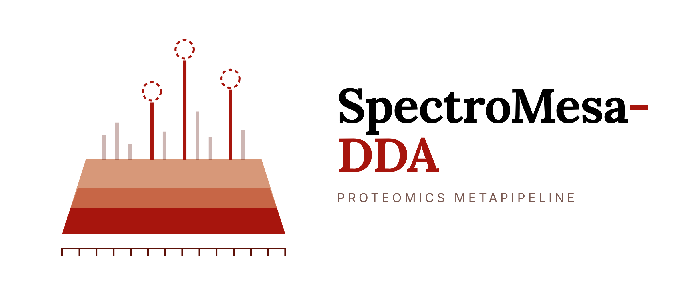

# SpectroMesa-DDA

SpectroMesa-DDA is a Nextflow pipeline for analyzing unfractionated and fractionated DDA proteomics experiments with label-free or TMT quantitation.

Start with the [overview](docs/overview.md) and [installation guide](docs/installation.md).

[Download the latest release](https://github.com/TheBoutrosLab/SpectroMesa-DDA/releases/latest) · [Run an analysis](docs/execution.md) · [Run the tests](docs/testing.md) · [Pipeline reference](docs/parameters.md)

[BSD 3-Clause License](LICENSE). Copyright © 2026 Sanford Burnham Prebys Medical Discovery Institute (Boutros Lab).
