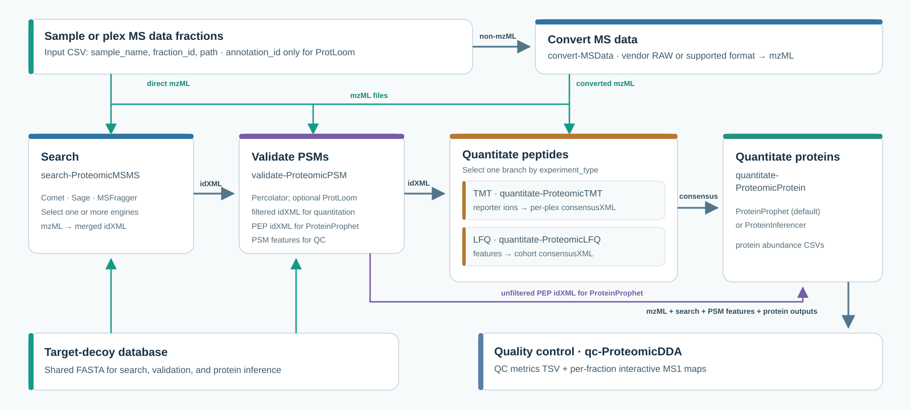

# SpectroMesa-DDA overview

SpectroMesa-DDA analyzes data-dependent acquisition (DDA) proteomics experiments, from mass spectrometry data to peptide and protein abundances. It supports label-free quantitation (LFQ) and tandem mass tag (TMT) experiments, including fractionated samples, and brings together database searching, identification validation, quantitation, quality control, and optional database assembly.

The pipeline uses **Nextflow** to orchestrate individual tools and analysis steps. Its spectrum-based workflow connects database searching and peptide-spectrum match (PSM) validation to peptide quantitation, protein grouping, and protein quantitation. [1](#ref-1)

## Workflow

*Data already in mzML format enter the search stage directly; other supported formats pass through conversion. After identification validation, the workflow follows either the LFQ or TMT branch before returning to shared protein quantitation and quality control. ProteoVault assembly is optional.*

## Major components

### MS data conversion

**ProteoWizard msconvert** converts supported vendor data to mzML, the format used by downstream stages. **OpenMS** provides an alternative conversion route for supported open formats, along with peak-picking and indexing options. Conversion is skipped when the input is already mzML. [2](#ref-2), [3](#ref-3)

### Database search

**MSFragger**, **Comet**, and **Sage** match tandem mass spectra to candidate peptides from a target-decoy protein sequence database. MSFragger is the default search engine; a run can use one engine or combine several. Search results provide the candidate peptide-spectrum matches (PSMs) evaluated during validation. [4](#ref-4), [5](#ref-5), [6](#ref-6)

### Identification validation

**Percolator** rescores candidate PSMs to distinguish likely correct matches from decoys. The default route uses OpenMS tools to prepare and process the rescoring results; the optional **MSBooster** route adds features derived from predicted peptide properties before Percolator rescoring. When multiple search engines are selected, **OpenMS ConsensusID** combines their identification evidence before the accepted identifications are passed to peptide quantitation. [2](#ref-2), [7](#ref-7), [8](#ref-8)

### Peptide quantitation

**LFQ** uses **OpenMS FeatureFinderIdentification** to extract chromatographic MS1 features guided by peptide identifications. OpenMS alignment and feature-linking tools bring corresponding features together across samples, producing a quantitative feature map for downstream protein quantitation. [2](#ref-2)

**TMT** uses **OpenMS IsobaricAnalyzer** to extract reporter-ion intensities and associate them with identified peptides and sample channels. The default workflow quantifies reporter signals; an experimental alternative combines MS1 feature areas with reporter-ion proportions. Both routes produce a quantitative feature map for protein quantitation. [2](#ref-2)

### Protein inference and quantitation

The default route combines identification evidence with **iProphet** and infers protein groups with **ProteinProphet**. An alternative uses **OpenMS ProteinInference**, selected as the ProteinInferencer route. **OpenMS ProteinQuantifier** then summarizes peptide evidence into peptide and protein abundance tables using the selected protein groups. [2](#ref-2), [9](#ref-9), [10](#ref-10)

### Quality control

The DDA QC pipeline uses **pyOpenMS** and dedicated summary scripts to examine acquisition data, search results, validated identifications, protein groups, and quantitative outputs. It produces cohort QC tables and interactive MS1 plots to help inspect signal quality and variation across samples or TMT plexes. [2](#ref-2)

### Results database

**[ProteoVault](https://github.com/TheBoutrosLab/package-ProteoVault)** optionally assembles the completed identification, quantitation, and QC results into a validated **DuckDB** database. This provides a common entry point for querying the cohort while retaining the individual pipeline outputs. The generated DuckDB database can be imported and analyzed in R using [ProteoVaultR](https://github.com/TheBoutrosLab/package-ProteoVaultR).

## References

1. **Nextflow:** Di Tommaso P et al. (2017). Nextflow enables reproducible computational workflows. *Nature Biotechnology*. [doi:10.1038/nbt.3820](https://doi.org/10.1038/nbt.3820).
2. **OpenMS:** Pfeuffer J et al. (2024). OpenMS 3 enables reproducible analysis of large-scale mass spectrometry data. *Nature Methods*. [doi:10.1038/s41592-024-02197-7](https://doi.org/10.1038/s41592-024-02197-7).
3. **ProteoWizard:** Kessner D et al. (2008). ProteoWizard: open source software for rapid proteomics tools development. *Bioinformatics*. [doi:10.1093/bioinformatics/btn323](https://doi.org/10.1093/bioinformatics/btn323).
4. **MSFragger:** Kong AT et al. (2017). MSFragger: ultrafast and comprehensive peptide identification in mass spectrometry-based proteomics. *Nature Methods*. [doi:10.1038/nmeth.4256](https://doi.org/10.1038/nmeth.4256).
5. **Comet:** Eng JK, Jahan TA, Hoopmann MR (2013). Comet: an open-source MS/MS sequence database search tool. *Proteomics*. [doi:10.1002/pmic.201200439](https://doi.org/10.1002/pmic.201200439).
6. **Sage:** Lazear MR (2023). Sage: an open-source tool for fast proteomics searching and quantification at scale. *Journal of Proteome Research*. [doi:10.1021/acs.jproteome.3c00486](https://doi.org/10.1021/acs.jproteome.3c00486).
7. **Percolator:** Käll L et al. (2007). Semi-supervised learning for peptide identification from shotgun proteomics datasets. *Nature Methods*. [doi:10.1038/nmeth1113](https://doi.org/10.1038/nmeth1113).
8. **MSBooster:** Yang KL et al. (2023). MSBooster: improving peptide identification rates using deep learning-based features. *Nature Communications*. [doi:10.1038/s41467-023-40129-9](https://doi.org/10.1038/s41467-023-40129-9).
9. **iProphet:** Shteynberg D et al. (2011). iProphet: multi-level integrative analysis of shotgun proteomic data improves peptide and protein identification rates and error estimates. *Molecular & Cellular Proteomics*. [doi:10.1074/mcp.M111.007690](https://doi.org/10.1074/mcp.M111.007690).
10. **ProteinProphet:** Nesvizhskii AI et al. (2003). A statistical model for identifying proteins by tandem mass spectrometry. *Analytical Chemistry*. [doi:10.1021/ac0341261](https://doi.org/10.1021/ac0341261).
